#+TITLE: pymodalhammer — User Manual
#+SUBTITLE: Impact-hammer modal testing with NI-DAQmx · version 0.1.0b1 (first beta)
#+AUTHOR: The pymodalhammer authors
#+DATE: November 2026
#+LANGUAGE: en
#+STARTUP: overview
#+OPTIONS: toc:2 num:t ^:{} H:4 broken-links:mark ':t
#+LATEX_CLASS: article
#+LATEX_CLASS_OPTIONS: [a4paper,11pt]
#+LATEX_COMPILER: xelatex
#+LATEX_HEADER: \usepackage{fontspec}
#+LATEX_HEADER: \setmainfont{DejaVu Sans}[Scale=0.92]
#+LATEX_HEADER: \setmonofont{DejaVu Sans Mono}[Scale=0.82]
#+LATEX_HEADER: \usepackage[margin=2.1cm]{geometry}
#+LATEX_HEADER: \usepackage{parskip}
#+LATEX_HEADER: \usepackage{float}
#+LATEX_HEADER: \usepackage{tabularx}
#+LATEX_HEADER: \usepackage{booktabs}
#+LATEX_HEADER: \usepackage{xcolor}
#+LATEX_HEADER: \usepackage{caption}
#+LATEX_HEADER: \captionsetup{font=small,labelfont=bf}
#+LATEX_HEADER: \hypersetup{colorlinks=true,linkcolor=blue!50!black,urlcolor=blue!60!black}
#+LATEX_HEADER: \renewcommand{\arraystretch}{1.25}
#+LATEX_HEADER: \renewcommand\tabularxcolumn[1]{>{\raggedright\arraybackslash}p{#1}}
#+LATEX_HEADER: \setcounter{tocdepth}{2}

#+BEGIN_EXPORT latex
\clearpage
#+END_EXPORT

* About pymodalhammer
pymodalhammer is a desktop program for *impact-hammer modal testing* with National Instruments
data-acquisition hardware (CompactDAQ chassis such as the cDAQ-9174 with IEPE input modules such
as the NI 9234). You strike a structure with an instrumented hammer; the program detects every
hit, checks it, averages the good ones and computes frequency response functions (FRFs) between
the hammer force and every response sensor. Results are saved in standard formats (UFF 58 for
FRFs, TDMS for time data) that open in modal-analysis software, DIAdem, LabVIEW or Python.

** What it does
- *Continuous acquisition with a pre-trigger.* The inputs run without gaps; every hit on the hammer
  channel is captured with a part of the signal from just before the impact. No hit is missed
  between records.
- *Quality checks on every hit*: overload, double hit (hammer bounce), hammer force outside a
  range, and responses that have not died out by the end of the record. For each check you choose
  what happens: reject, ask you, accept but flag, or ignore.
- *Automatic or manual acceptance.* In manual mode every hit waits for your Accept / Reject.
- *Full control over earlier hits.* Any hit can be deleted or put back into the average at any
  time; the FRF updates instantly.
- *Force and exponential windows*, with the damping added by the exponential window shown.
- *H1, H2, Hv and coherence*, averaged over the hits you keep.
- *Probe mode*: tap the structure and see the level of every channel, the hammer's frequency
  content and suggestions for the trigger level and input ranges, without measuring.
- *Roving-hammer workflow*: the hammer position is the measurement point; after saving, the point
  number advances automatically, optionally without stopping the acquisition.
- *External trigger output* (e.g. for a high-speed camera): a pulse at the start, on every hit, on
  every accepted hit, on the first hit of a point or when a point is complete, or a frame clock
  locked to the sample clock. Every pulse is logged with its exact sample index.
- *Data Viewer*: FRFs, time data and spectra of saved points; re-processing with other hits or other
  windows; comparison of several points (FRF, amplitude spectrum and time data).
- *Simulation mode*: a simulated hammer and structure, so everything can be tried without hardware.

** Status of this version
This is *version 0.1.0b1, the first beta*. All features are complete. They are covered by automated
tests in simulation mode and by tests of the NI-DAQmx code against a mock driver that reproduces the
limits of real modules (e.g. the NI 9260). Behaviour on your own hardware has to be confirmed on your
system: check results against a known reference before relying on them, and report problems
(see [[*Reporting problems]]).

** Licence
pymodalhammer is free software, released under the *GNU General Public License, version 3 or
(at your option) any later version* (GPL-3.0-or-later). You may use, study, share and modify it;
if you distribute modified versions, they must be released under the same licence. The program
comes *without any warranty*. The full text is in the file =LICENSE=.

* Installation
** Requirements
#+ATTR_LATEX: :environment tabularx :width \textwidth :align l|X
| Item                  | Notes                                                                                     |
|-----------------------+-------------------------------------------------------------------------------------------|
| Python                | 3.9 or newer                                                                              |
| NI-DAQmx driver       | from ni.com, only needed with hardware (Linux and Windows are supported by NI)            |
| Python packages       | PySide6, pyqtgraph, numpy, scipy, nidaqmx, pyuff, npTDMS (installed automatically)        |
| Hardware (optional)   | an NI CompactDAQ chassis with IEPE input modules; optionally an AO or DO module for the external trigger |

** Installing
From the project folder (the one that contains =pyproject.toml=):
#+begin_src sh
python -m pip install .            # installs pymodalhammer and its dependencies
pymodalhammer                      # starts the program
#+end_src
Alternatively, without installing:
#+begin_src sh
python -m pip install -r requirements.txt
python -m pymodalhammer            # run from the project folder
#+end_src
A virtual environment (=python -m venv .venv=) keeps the packages separate from the system's.

** First start and simulation mode
At start-up the program looks for NI devices. If it finds none (or the driver is not installed),
it starts in *Simulation mode*: the status bar shows =SIMULATION MODE= in orange. A simulated hammer
then strikes a simulated structure with three modes (at about 123, 348 and 696 Hz with the default
sampling rate) every 1.6–3.2 s. About one hit in ten is a double hit and the occasional hard hit
overloads the hammer channel, so every feature can be tried. Use *Hardware → Simulation mode* to
switch, *Hardware → Refresh NI devices* (F5) after connecting the chassis, and *Hardware → Simulator:
random hits* to make the simulated hammer strike only when you press *Simulate a hit*.

* Quick start
The fastest way to learn the program is to do these steps once in simulation mode.
1. *Channel Setup*: check that the hammer row is ticked as /Reference/ and that the accelerometers
   are enabled (see [[*Channel Setup]]).
2. *Acquisition Setup → Probe mode*: press /Start probe/ and tap the structure (or wait for the
   simulator). Check the level meters and the hammer spectrum; press /Use suggested trigger level/.
   Press /Stop/ (see [[*Probe mode]]).
3. *Acquisition Setup*: check the record length, the windows and the number of averages
   (see [[*Acquisition Setup]]).
4. *Measurement*: choose the output folder and the hammer node of the first point.
5. Press *Start*. Wait until the status reads =ARMED=, then hit the structure. Each hit appears in the
   list; the plots and the FRF update.
6. When the point has its averages the acquisition stops. Look through the hits, delete any you do
   not like, and press *Save point*. The node number advances by one.
7. Move the hammer to the next point and repeat from step 5.
8. *Data Viewer*: look at the saved points and compare them (see [[*Data Viewer]]).

* The main window
#+CAPTION: The main window with its four tabs. The status bar at the bottom shows whether the program works with hardware or in simulation.
#+ATTR_LATEX: :width \textwidth :placement [H]
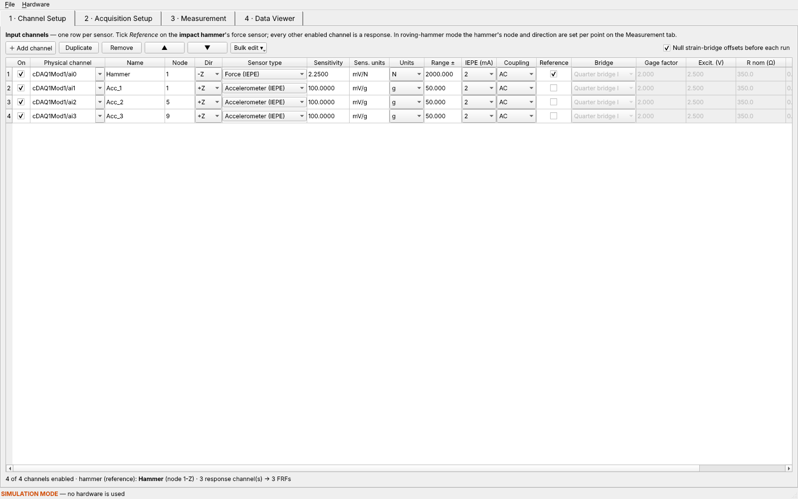

The work is organised in four tabs, used from left to right:
#+ATTR_LATEX: :environment tabularx :width \textwidth :align l|X
| Tab                    | Purpose                                                                                       |
|------------------------+-----------------------------------------------------------------------------------------------|
| 1 · Channel Setup      | which sensors are connected where, their sensitivities, ranges, nodes and directions          |
| 2 · Acquisition Setup  | record, trigger, windows, averaging, hit checks, external trigger; Probe mode                 |
| 3 · Measurement        | what to save, the measurement point, the hits and the live results                           |
| 4 · Data Viewer        | saved points: FRFs, time data, spectra, re-processing and comparison                          |

*Menus*
- *File*: /New setup/ (Ctrl+N), /Open setup…/ (Ctrl+O), /Save setup/ (Ctrl+S), /Save setup as…/,
  /Quit/ (Ctrl+Q). A setup is a JSON file with every setting of every tab. The last setup is
  restored automatically when the program starts.
- *Hardware*: /Refresh NI devices/ (F5), /Simulation mode/, /Simulator: random hits/.

While an acquisition runs, the settings that must not change are locked; they unlock when it stops.
Every tab scrolls if the screen is smaller than its content, so the window can always be maximised.

* Channel Setup
One row per sensor. The table is the same as in the companion shaker program.

#+ATTR_LATEX: :environment tabularx :width \textwidth :align l|X
| Column            | Meaning                                                                                                  |
|-------------------+----------------------------------------------------------------------------------------------------------|
| On                | include the channel                                                                                      |
| Physical channel  | DAQmx name, e.g. =cDAQ1Mod1/ai0= (pick from the list or type)                                            |
| Name              | used in plots, files and to match channels between runs; keep names unique                              |
| Node, Dir         | geometry node and direction (±X/Y/Z) written into the UFF files                                          |
| Sensor type       | accelerometer, force, microphone, pressure (IEPE), strain gauge, voltage or custom                     |
| Sensitivity       | from the calibration sheet, in the units shown in /Sens. units/ (e.g. mV/N for the hammer)              |
| Units, Range ±    | engineering unit and the largest expected level; the range also sets the overload check                |
| IEPE (mA), Coupling | IEPE excitation current (0 = off) and coupling (AC for IEPE sensors)                                 |
| Reference         | *tick this on the hammer.* FRFs are response / hammer force                                              |
| Bridge …          | strain-gauge settings (bridge type, gage factor, excitation, resistance, Poisson's ratio)               |

Use /+ Add channel/, /Duplicate/, /Remove/ and the arrows to edit the list. /Bulk edit/ numbers
nodes, copies sensor settings to several rows, or adds every channel of a module. The line under
the table summarises the setup (number of channels, the hammer, the number of FRFs).

#+begin_quote
*Tip.* Typical impact hammers have a sensitivity of 1–25 mV/N. With an NI 9234 (±5 V input) a
hammer of 2.25 mV/N can measure up to about 2200 N. Probe mode suggests sensible ranges.
#+end_quote

In a *roving-hammer* test the hammer's node and direction in this table are not used: they are set
per measurement point on the Measurement tab (see [[*Measurement point]]).

* Acquisition Setup
#+CAPTION: Acquisition Setup. Left: all settings (the column scrolls). Right: a summary in plain words, a preview of the record and its windows, and the external trigger pulse.
#+ATTR_LATEX: :width \textwidth :placement [H]
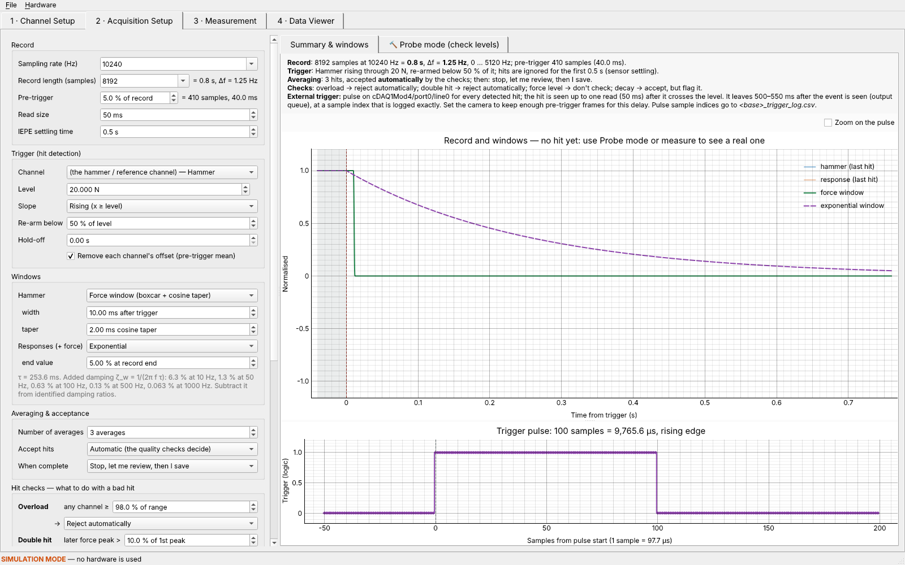

The summary on the right is rewritten whenever a setting changes. Read it before measuring: it
states the record length, the frequency resolution, when the trigger fires, what happens to bad hits
and when external-trigger pulses leave.

** Record
#+CAPTION: Record settings.
#+ATTR_LATEX: :width 0.55\textwidth :placement [H]
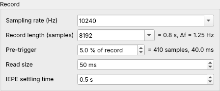

- *Sampling rate*: the analysis goes up to half of it (the Nyquist frequency). Delta-sigma modules
  such as the NI 9234 only allow rates of 51.2 kHz / n (e.g. 10 240, 12 800, 25 600 Hz); if
  another rate is entered, DAQmx uses the nearest allowed one and the program uses, logs and saves
  the rate actually used.
- *Record length* N (samples): the record time is \(T = N/f_s\) and the frequency resolution
  \(\Delta f = f_s/N\). Choose T long enough for the response to die out (or nearly so — the
  exponential window does the rest).
- *Pre-trigger*: the part of the record before the trigger point, in % of the record. A few percent
  is enough to see the start of the pulse and to estimate the sensor offsets.
- *Read size*: the acquisition is read in pieces of this length (default 50 ms). It sets how
  quickly a hit is noticed and how often the screen updates. Keep it ≥ 20 ms over USB.
- *IEPE settling time*: hits are ignored for this long after Start, while IEPE sensors and
  AC coupling settle.

#+ATTR_LATEX: :environment tabularx :width \textwidth :align X|X
| Goal                                   | Do                                                       |
|----------------------------------------+----------------------------------------------------------|
| finer frequency resolution             | longer record (more samples, or a lower rate)            |
| higher frequency range                 | higher sampling rate (and a harder hammer tip)           |
| lightly damped structure               | longer record and/or a stronger exponential window       |

** Trigger (hit detection)
#+CAPTION: Trigger settings.
#+ATTR_LATEX: :width 0.55\textwidth :placement [H]
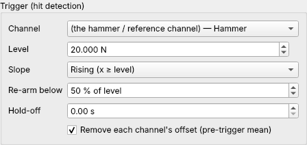

- *Channel*: normally the hammer (the reference channel); any channel can be used.
- *Level* and *Slope*: a hit is detected when the signal crosses the level — /rising/ (x ≥ level),
  /falling/ (x ≤ −level) or /either/ (|x| ≥ level). The first sample past the level is the
  *trigger point*, time t = 0 in all plots and files. Set the level well above the noise and well
  below a light tap (Probe mode suggests 10 % of a typical hit).
- *Re-arm below*: after a record, the trigger only re-arms once the signal has dropped below this
  fraction of the level (hysteresis). A ringing hammer therefore cannot trigger twice.
- *Hold-off*: an optional extra dead time after each record.
- *Remove each channel's offset*: subtracts the mean of the pre-trigger part of every channel.

Because the acquisition is continuous and buffered, a record never overlaps the previous one and
the pre-trigger is always available, however soon after the previous record a hit comes.

** Windows
#+CAPTION: Window settings. The line below them gives the time constant of the exponential window and the damping it adds.
#+ATTR_LATEX: :width 0.55\textwidth :placement [H]
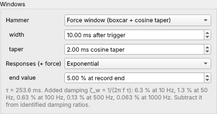

- *Hammer: force window*. The hammer signal is kept from the start of the record to /width/ after the
  trigger point, then brought to zero by a half-cosine over /taper/. This removes the noise the
  hammer channel picks up after the impact. The width must cover the whole pulse (typically
  1–5 ms) — check it on a real hit (figure below).
- *Responses: exponential window*. From the trigger point on, every channel is multiplied by
  \(e^{-t/\tau}\), chosen so that it has fallen to /end value/ at the end of the record. Responses
  that would still ring at the end of the record are forced to decay, which avoids leakage. The
  window is applied to the hammer too, so the FRF stays consistent.

The exponential window adds damping to every mode. The added damping ratio at frequency f is
\[ \zeta_w = \frac{1}{2\pi f \tau} \]
and the panel lists it at a few frequencies. *Subtract it from damping ratios identified from the
FRFs.* The time constant τ is saved with every point. Use the mildest window that removes the
leakage (an end value of 1–10 % is typical); with a long enough record use none.

#+CAPTION: The window preview drawn over a real hit (from Probe mode or a measurement), zoomed on the impact: hammer (blue), first response (orange), force window (green) and exponential window (purple, dashed). Below: the external trigger pulse.
#+ATTR_LATEX: :width 0.85\textwidth :placement [H]
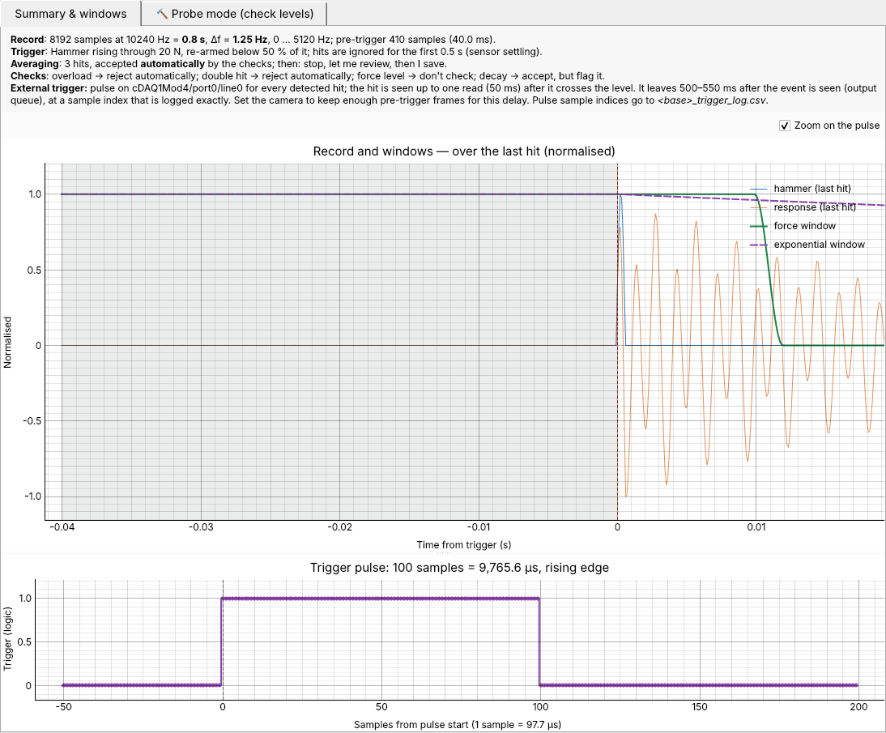

#+CAPTION: The same preview over the whole record: the response decays inside the exponential window.
#+ATTR_LATEX: :width 0.85\textwidth :placement [H]
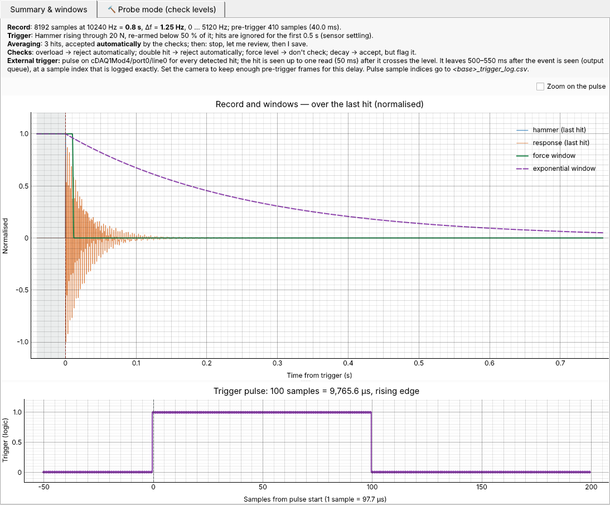

** Averaging and acceptance
#+CAPTION: Averaging and acceptance.
#+ATTR_LATEX: :width 0.55\textwidth :placement [H]
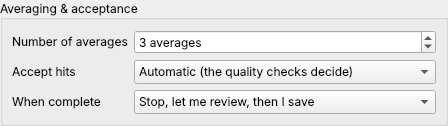

- *Number of averages*: how many good hits a point needs (typically 3–10).
- *Accept hits*:
  - /Automatic/: the hit checks decide (next section).
  - /Manual/: every hit waits for you to press *Accept (A)* or *Reject (R)*; the check results are
    shown as advice. The trigger stays disarmed until you decide.
- *When complete*:
  - /Stop, let me review, then I save/ (default): the acquisition stops; you look through the hits and
    press /Save point/.
  - /Stop and save automatically/.
  - /Save, then re-arm for the next point (roving hammer)/: the point is saved, the hammer node
    advances and the trigger re-arms *without stopping the acquisition* — the fastest way through a
    grid of points.

** Hit checks — what to do with a bad hit
#+CAPTION: Hit checks: a threshold and an action per check.
#+ATTR_LATEX: :width 0.55\textwidth :placement [H]
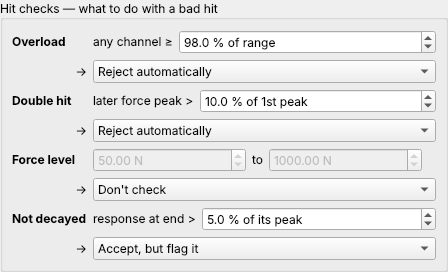

#+ATTR_LATEX: :environment tabularx :width \textwidth :align l|X|l
| Check        | A hit fails when                                                                                                   | Default action       |
|--------------+--------------------------------------------------------------------------------------------------------------------+----------------------|
| Overload     | any channel reaches the given % of its range                                                                       | reject               |
| Double hit   | after the main pulse has ended (force below 5 % of its peak), the force rises again above the given % of the peak  | reject               |
| Force level  | the peak hammer force is outside the given minimum … maximum                                                       | don't check          |
| Not decayed  | a response, over the last 5 % of the record, is still above the given % of its peak (RMS·√2)                      | accept, but flag it  |

The actions:
#+ATTR_LATEX: :environment tabularx :width \textwidth :align l|X
| Action                   | Effect                                                                                            |
|--------------------------+---------------------------------------------------------------------------------------------------|
| Reject automatically     | the hit is not averaged; it stays in the list (red) and the trigger re-arms at once               |
| Ask me                   | the hit waits for Accept / Reject (orange bar on the Measurement tab); the trigger is disarmed    |
| Accept, but flag it      | the hit is averaged but marked (orange) so you can review and delete it later                     |
| Don't check              | the check is switched off                                                                         |

If several checks fail, the strictest action wins (reject before ask before flag).

** External trigger (e.g. a high-speed camera)
#+CAPTION: External trigger settings.
#+ATTR_LATEX: :width 0.55\textwidth :placement [H]
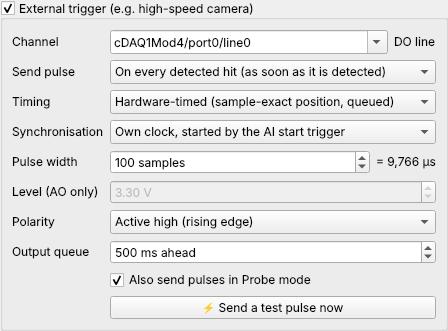

Tick the box to send a pulse to another device. Typical uses: start or mark the recording of a
high-speed camera, tell a robot or an automatic hammer that a point is done, or mark hits on a
second acquisition system.

*Channel*: an analog output (=…/aoN=) or a digital line (=…/portN/lineM=); for frame sync, a PFI
terminal (=/cDAQ1Mod4/PFI0=). The label next to it shows how the channel was recognised.

*Send pulse* — when:
#+ATTR_LATEX: :environment tabularx :width \textwidth :align l|X
| Mode                                            | The pulse is sent                                                                                       |
|-------------------------------------------------+---------------------------------------------------------------------------------------------------------|
| Once, when the acquisition starts               | at sample 0 (exactly)                                                                                   |
| On every detected hit                           | as soon as a hit crosses the trigger level (before the record is complete and before any check)        |
| On every accepted hit                           | when the record is complete and passed the checks — or when you press Accept                           |
| On the first hit of each measurement point      | for the first hit after a point is started                                                             |
| When the averages of a point are complete       | when the last average has been accepted                                                                 |
| Frame sync                                      | the input sample clock itself is routed to a PFI pin: one pulse per sample, for the whole run           |

*Timing*:
- /Hardware-timed/ (default, recommended). The trigger line is driven by a continuous output task
  that runs in step with the inputs. The output is prepared ahead of time (the *output queue*,
  default 500 ms) and a pulse is written into the next part to go out. So *a pulse leaves about one
  output queue after the event*, at a sample index that is known exactly and logged. The output
  queue is also the slack the computer has: if the program is held up for longer, the output runs
  dry and the run stops with an "underflow" message. Increase the queue to 1000–2000 ms on a busy
  computer.
- /On-demand/. The line is switched by the program as soon as the event is seen (a few ms over USB).
  The logged sample index is approximate. Needs an output that allows software-timed writes: digital
  lines and most AO modules, but *not* delta-sigma AO modules such as the NI 9260.

*Synchronisation* (hardware-timed only):
- /Own clock, started by the AI start trigger/ (default): works with every module combination.
- /Clocked by the AI sample clock/: exact lockstep, but many module combinations refuse it; the
  program then falls back to the first option by itself and says so in the log.

*Pulse width* (samples, with the time shown), *Level* (analog outputs only; 3.3 V is enough for TTL
inputs, which read ≥ 2 V as high), and *Polarity* (active high = rising edge, active low = falling
edge). /Also send pulses in Probe mode/ lets you check the wiring while probing.
*Send a test pulse now* sends one pulse when nothing is running.

#+begin_quote
*Using a camera with a hit-based pulse.* A hit can only be detected after it has happened, so a
pulse "on every hit" always comes /after/ the impact: about 0.5 s later with the default output
queue. Use a camera with a ring (pre-trigger) buffer and set it to keep at least that much before
the trigger (end-trigger or centre-trigger mode). The trigger log gives every pulse's sample index,
so camera frames can be aligned with the hit records afterwards:
frame offset = (pulse sample − hit trigger sample) × fps / fs.

*Frame sync* removes all of this: the camera, in external-sync mode, exposes one frame per input
sample, so frame f is sample f, and each hit's trigger sample (in the hit log) is its frame number.
#+end_quote

* Probe mode
Probe mode answers "what am I going to measure?" before you measure. It is on the right of the
Acquisition Setup tab, under *Probe mode (check levels)*. Nothing is averaged or saved.

#+CAPTION: Probe mode: level meters with peak hold, suggestions, the last hit's checks and hammer bandwidth, the live signals, the last hit and the hammer force spectrum.
#+ATTR_LATEX: :width \textwidth :placement [H]
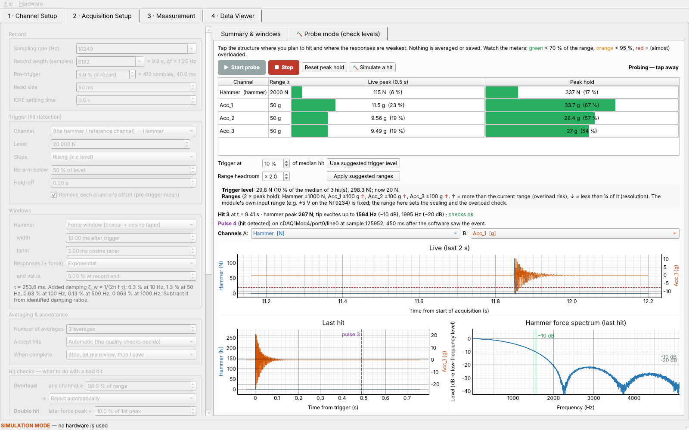

Press *Start probe* and tap the structure where you plan to hit, and also where the responses
are weakest.
- *Level meters*: for every channel, the live peak (last 0.5 s) and the peak hold, as a percentage
  of its range: green below 70 %, orange below 95 %, red at 95 % and above. /Reset peak hold/ starts
  again.
- *The last hit*: its time history (channels A and B) and the *hammer force spectrum* in dB, with the
  −10 dB and −20 dB lines. The hammer tip excites the structure reliably up to about the −10 dB
  frequency, which is printed under the meters. If it is below the highest frequency you care about,
  use a harder tip (or a lighter hammer).
- *Checks*: every probe hit is checked (double hit, overload, …) and the result is printed.
- *Suggestions*: a trigger level (a chosen percentage of the median hammer peak) and input ranges
  (a headroom factor times the peak hold, rounded up to 1, 2 or 5 × 10ⁿ). An up arrow (↑) marks a
  range larger than the present one (overload risk), a down arrow (↓) one less than a quarter of it
  (poor resolution). /Use suggested trigger level/ sets it on the left; /Apply suggested ranges/ writes
  the ranges into the Channel Setup table after asking.
- *Simulate a hit* (simulation mode only) strikes the simulated structure at once.

#+CAPTION: Probe mode with the external trigger: the trigger output is recorded and shown as channel B. The hit is at t = 0; the pulse (purple marker, "pulse 1") leaves about 450 ms later, i.e. one output queue.
#+ATTR_LATEX: :width \textwidth :placement [H]
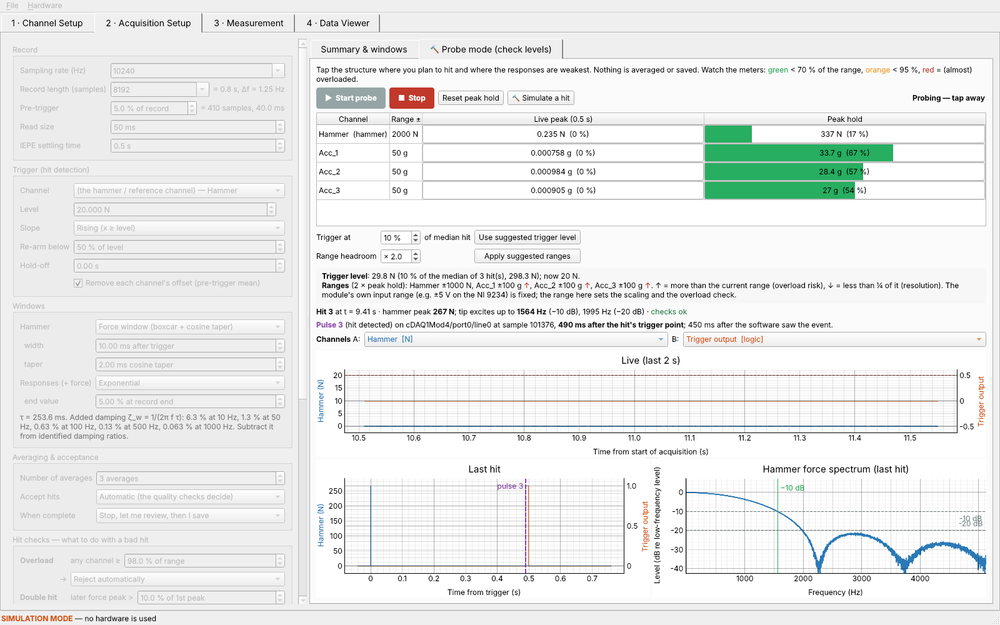

With *Also send pulses in Probe mode* ticked, the pulses are shown too. With hardware timing the
trigger output is recorded sample by sample and can be chosen as channel A or B (/Trigger output/,
chosen as B by default); every pulse is marked with a purple dashed line, and the panel states its
sample index and its delay after the hit. With on-demand timing there is no recorded waveform and
only the markers are shown. This is the easiest way to check the camera wiring and the delay to
set in the camera before measuring.

* Measurement
#+CAPTION: The Measurement tab while a point is being measured: save options and the measurement point at the top, the run controls, the hit list with a live view (left) and the hit plots (right).
#+ATTR_LATEX: :width \textwidth :placement [H]
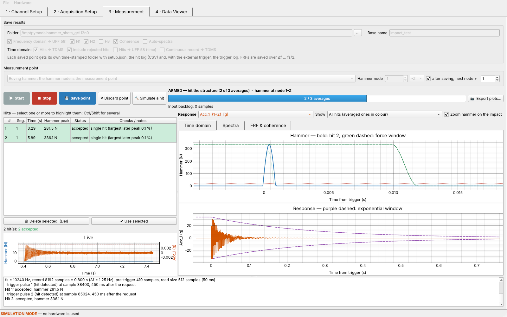

** Save options
#+CAPTION: Save options.
#+ATTR_LATEX: :width \textwidth :placement [H]
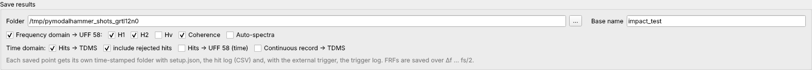

- *Folder* and *Base name*: every saved point gets its own sub-folder here (see [[*Saved files]]).
- *Frequency domain → UFF 58*: H1, H2, Hv, coherence, and the averaged auto-spectra.
- *Time domain*: /Hits → TDMS/ (the averaged hits; optionally also the rejected ones), /Hits → UFF 58
  (time)/, and /Continuous record → TDMS/ (everything acquired, as a safety copy).
- Always saved: the setup (=setup.json=), the hit log and, with the external trigger, the trigger log.

** Measurement point
#+CAPTION: The measurement point.
#+ATTR_LATEX: :width \textwidth :placement [H]
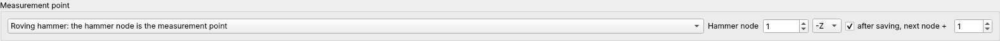

- /Roving hammer/ (default): the hammer is moved from point to point and the accelerometers stay.
  The *Hammer node* and *direction* given here are the reference node and direction of the point and
  are written into the UFF files. With /after saving, next node + n/ ticked, the node advances after
  every saved point.
- /Fixed hammer/: the hammer stays and the sensors are moved; nodes and directions come from the
  Channel Setup table.

** Running a point
The buttons:
#+ATTR_LATEX: :environment tabularx :width \textwidth :align l|X
| Button            | Action                                                                                     |
|-------------------+--------------------------------------------------------------------------------------------|
| Start / Continue  | starts the acquisition (Continue adds hits to a point that has hits already)               |
| Stop              | stops the acquisition; the hits are kept                                                    |
| Save point        | writes the point's files; enabled when there are averaged hits and none waits for a decision |
| Discard point     | forgets all hits of the point                                                              |
| Simulate a hit    | simulation mode only                                                                       |
| Export plots…     | saves the visible plots as PNG (2× resolution), SVG or PDF                                  |

The line next to the buttons tells you what the program is doing:
"Settling sensors…" (the IEPE settling time), "ARMED — hit the structure (n of N averages)",
"Waiting for your decision", or "Complete". The bar shows the averages collected, and /Input backlog/
warns if the computer cannot keep up. The log at the bottom records every hit, every decision,
every trigger pulse and every saved file.

If you change channels, record, trigger, windows or the point while a point has hits, *Continue*
asks whether to discard them: hits measured with different settings cannot be averaged together.

** The hit list
#+CAPTION: The hit list after the point above: three accepted hits, the double hit that was accepted (flagged, orange) and an overloaded hit rejected automatically (red). Hover over a row for the result of every check.
#+ATTR_LATEX: :width 0.6\textwidth :placement [H]
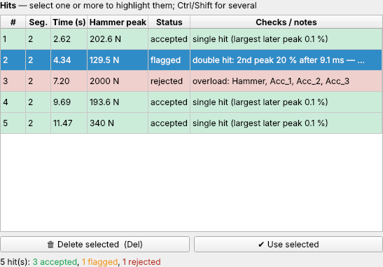

#+ATTR_LATEX: :environment tabularx :width \textwidth :align l|l|X
| Colour   | Status    | Meaning                                                         |
|----------+-----------+-----------------------------------------------------------------|
| green    | accepted  | averaged                                                        |
| orange   | flagged   | averaged, but a check failed (or you accepted a failed hit)     |
| red      | rejected  | not averaged (by a check or by you)                             |
| blue     | pending   | waits for your decision                                         |

Select one or more rows (Ctrl/Shift-click) to highlight those hits in every plot.
- *Delete selected* (Del key) deletes the hits for good: they leave the list and the average and
  are never saved.
- *Use selected* puts rejected hits into the average.
The FRF updates immediately.

** Manual review and "Ask me"
#+CAPTION: A hit waiting for a decision: a double hit, with the action "Ask me". The hammer plot (zoomed on the impact) shows the second, smaller impact a few milliseconds after the first, still inside the force window.
#+ATTR_LATEX: :width \textwidth :placement [H]
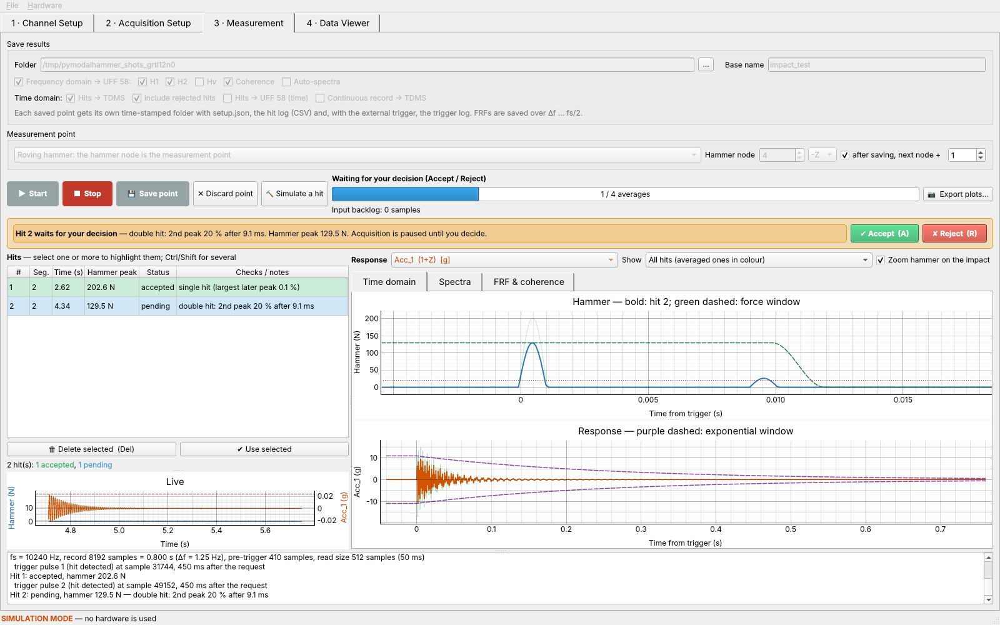

When a hit needs your decision, an orange bar names the hit and the reason. Look at the plots and
press *Accept* (key A) or *Reject* (key R). Acquisition pauses (the trigger is disarmed) until you
decide.

** Time domain, spectra and FRF
Above the plots: the *response* channel shown, *Show* (all hits with the averaged ones in colour,
averaged hits only, or only the selected / latest hit), and *Zoom hammer on the impact*.

#+CAPTION: Time domain: the hammer (top, zoomed on the impact, force window dashed green, trigger level dotted red) and the response (bottom, exponential window dashed purple). The selected hit is bold; the others are faint in their status colour.
#+ATTR_LATEX: :width \textwidth :placement [H]
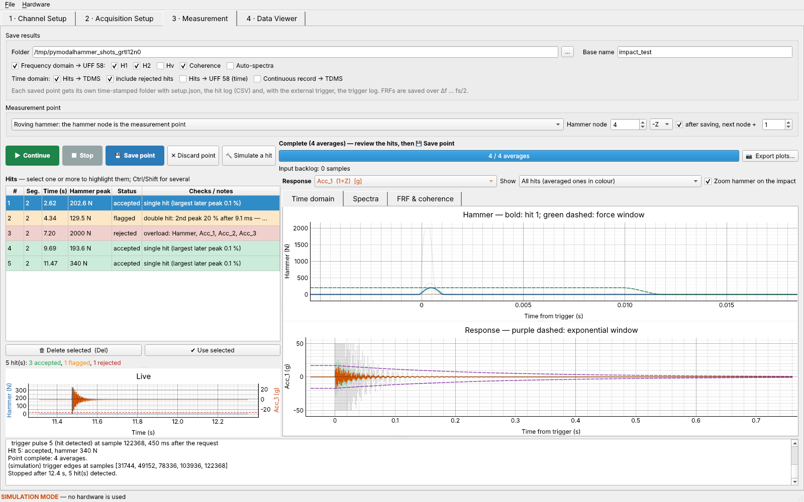

#+CAPTION: Spectra: the hammer force spectrum in dB (−10 dB frequency marked) and the response spectrum, per hit and averaged (black).
#+ATTR_LATEX: :width \textwidth :placement [H]
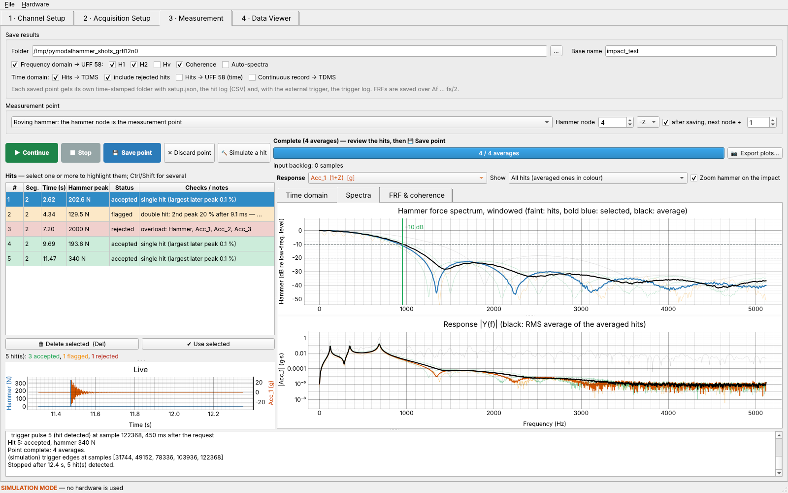

#+CAPTION: FRF and coherence. The grey curve is the selected hit's own FRF, useful to spot a hit that does not fit. The coherence falls above about 3 kHz because the simulated hammer tip hardly excites the structure there (compare the hammer spectrum).
#+ATTR_LATEX: :width \textwidth :placement [H]
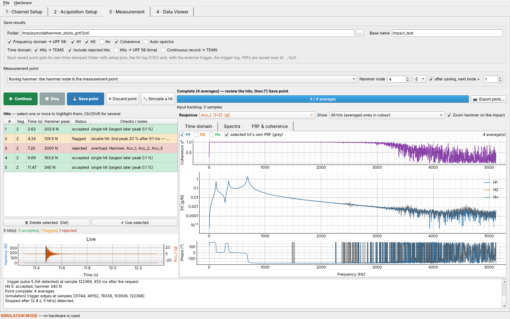

Reading the coherence: close to 1 where the hits agree and there is enough excitation; low at
anti-resonances (little response) and above the hammer tip's bandwidth (little force). A dip at a
resonance suggests leakage (use a longer record or the exponential window) or a non-linearity.

** Roving-hammer workflow, step by step
1. Mount the accelerometers; enter their nodes and directions in the Channel Setup table.
2. Probe the structure; set the trigger level and ranges from the suggestions.
3. On the Measurement tab choose /Roving hammer/, the first node and the hammer direction, and tick
   /after saving, next node + 1/.
4. Choose /When complete/: /Stop, let me review/ for careful work, or /Save, then re-arm/ for speed.
5. Start, hit the first point N times; review; save. The node advances.
6. Move to the next point and continue until the grid is done.
7. In the Data Viewer, compare the points (each curve is one hammer position).

* Data Viewer
#+CAPTION: Data Viewer, FRF page: the hits of the chosen run (left, ticked = used), the re-processing box, and the FRF recomputed from the ticked hits.
#+ATTR_LATEX: :width \textwidth :placement [H]
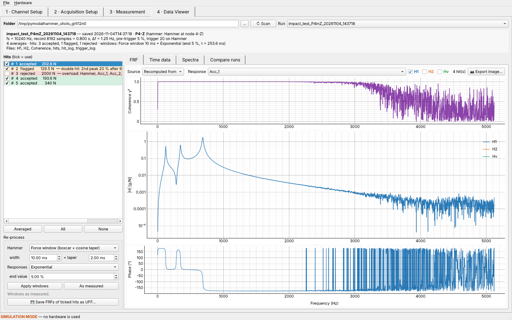

Enter a run folder or a folder of runs (press /Scan/), then choose a run. The box under the folder
summarises the run: point, sampling, record, averages, hits, windows and the files present. A
point you have just saved opens here automatically (during a roving-hammer run that keeps
acquiring, it opens when you go to this tab).

** Hits and re-processing
The list on the left shows every saved hit with its status. *Ticked hits are used* for the
recomputed FRF and the spectra; /Averaged/, /All/ and /None/ change the ticks. The highlighted row is
the hit drawn bold in the time and spectrum plots.

The *Re-process* box applies other windows to the ticked hits (/Apply windows/, back with /As
measured/). /Save FRFs of ticked hits as UFF…/ writes H1, H2, Hv and coherence of the ticked hits,
with these windows, to a folder you choose. The run itself is never modified.

#+CAPTION: Re-processing with a stronger exponential window (end value 1 % instead of 5 %): the resonance peaks become lower and wider (added damping).
#+ATTR_LATEX: :width \textwidth :placement [H]
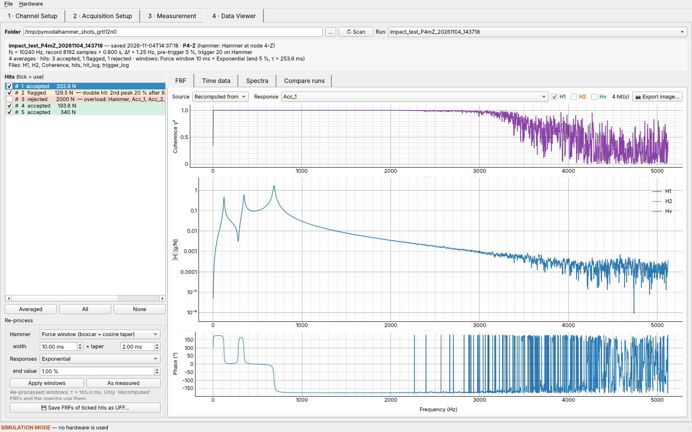

** FRF, time data and spectra
- *FRF*: source /Recomputed from the ticked hits/ or /Stored UFF files/ (exactly as saved); response
  channel; H1/H2/Hv; coherence, magnitude and phase.
- *Time data*: two channels (A, B) of all ticked hits (faint) and the selected hit (bold), with the
  windows and optionally the external-trigger output.
- *Spectra*: the Fourier transform |X(f)| of one channel for every ticked hit, the selected one and
  their RMS average; windowed or not; logarithmic or dB.

#+CAPTION: Data Viewer, time data of the hits of a point.
#+ATTR_LATEX: :width \textwidth :placement [H]
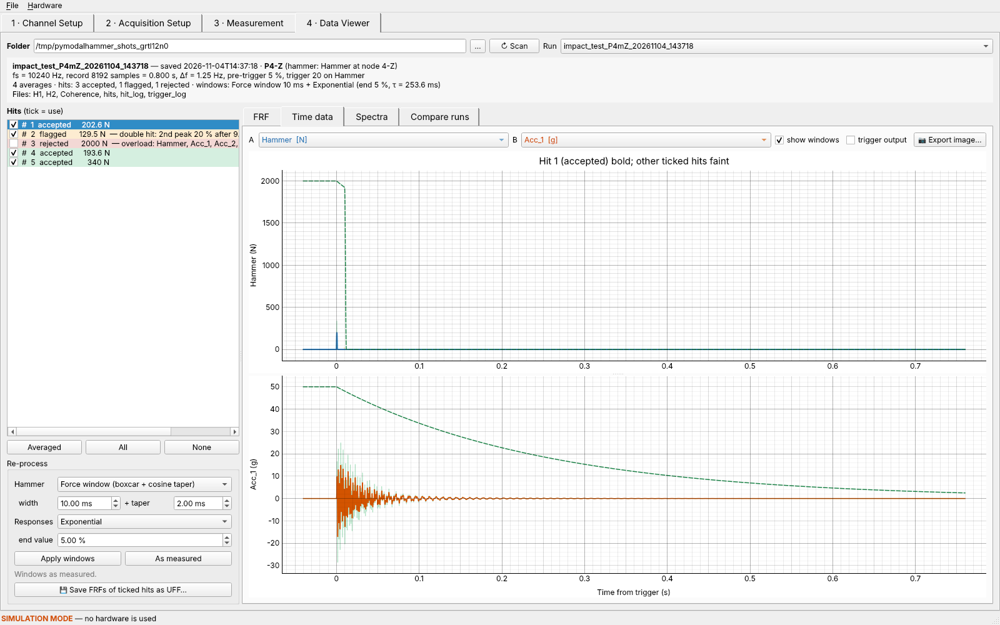

#+CAPTION: Data Viewer, spectra of the hammer for every hit and their average.
#+ATTR_LATEX: :width \textwidth :placement [H]
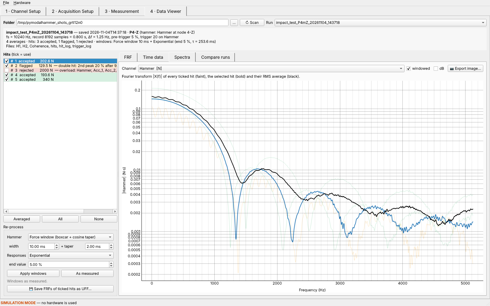

** Compare runs
Tick the runs to compare on the left (/Add runs from folder…/ adds runs from elsewhere), choose what
to show and the channel. Channels are matched by *name*; each run uses its own hammer reference, so
in a roving-hammer test every curve is one hammer position. The legend shows the point of each run.

#+CAPTION: Comparing the FRF of one accelerometer for four hammer points: the mode shapes make the curves differ.
#+ATTR_LATEX: :width \textwidth :placement [H]
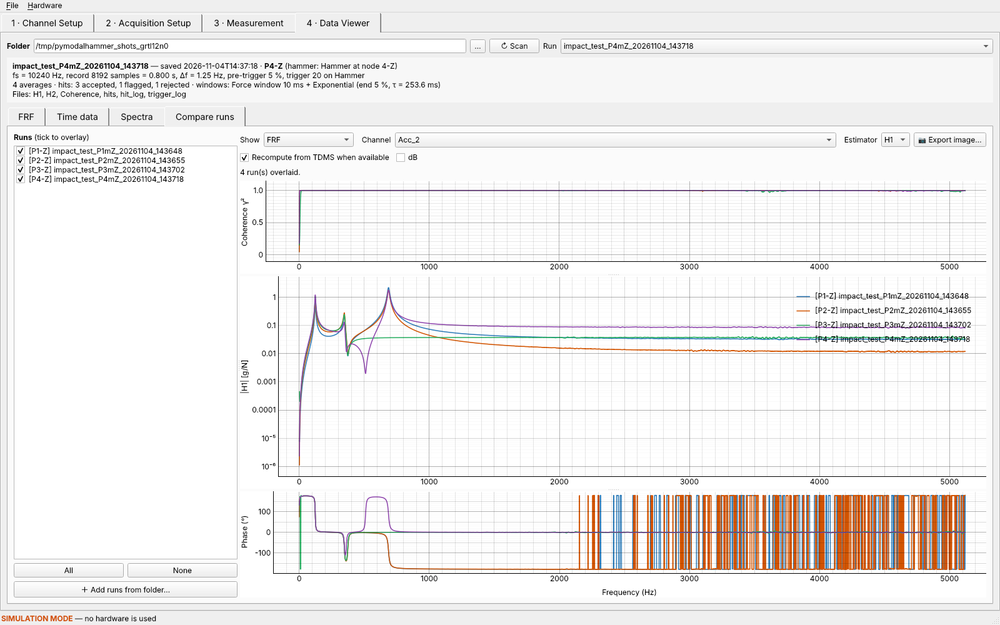

- *FRF*: H1/H2/Hv with coherence and phase. /Recompute from TDMS when available/ uses each run's
  averaged hits; otherwise the stored UFF files. /dB/ shows the magnitude in dB.
- *Amplitude spectrum*: the RMS-averaged |X(f)| of the channel.
- *Time data*: the /first averaged hit/, /every averaged hit/, a given /hit number/, or the /mean of the
  averaged hits/ of each run, all aligned at the trigger point. /÷ hammer peak/ divides each record by
  its hit's peak force, so hits of different strength can be compared; /windowed/ applies each run's
  windows; /zoom on impact/ shows the first 20 ms.

#+CAPTION: Comparing time data: the first averaged hit of each point, divided by its hammer peak.
#+ATTR_LATEX: :width \textwidth :placement [H]
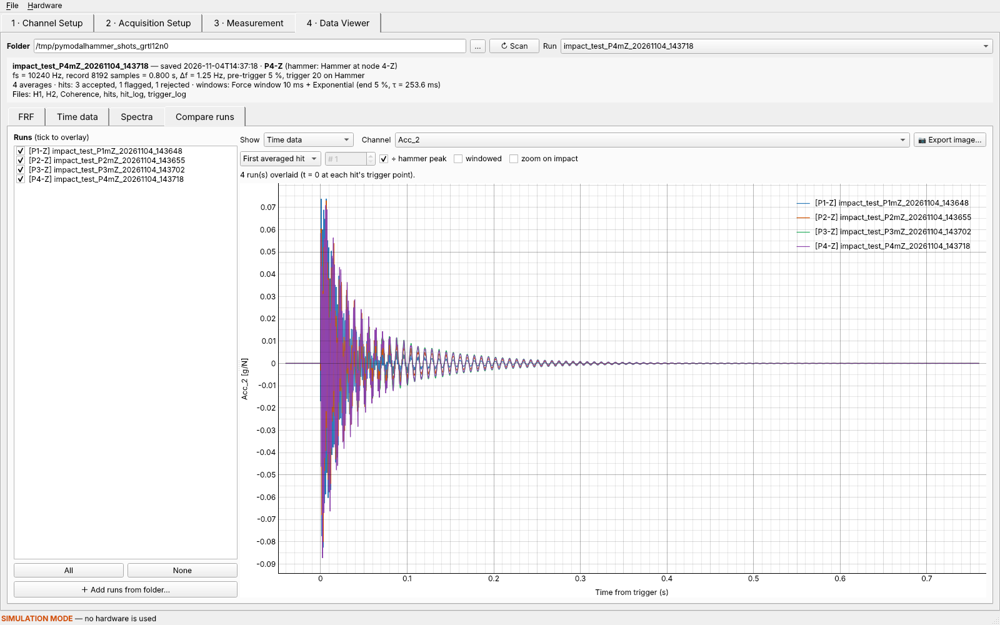

#+CAPTION: Comparing the hammer pulses of every averaged hit of four points (zoom on impact): a quick check that the hits were alike.
#+ATTR_LATEX: :width \textwidth :placement [H]
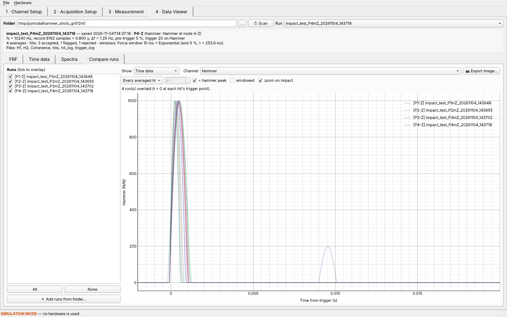

#+CAPTION: Comparing the hammer amplitude spectra of four points.
#+ATTR_LATEX: :width \textwidth :placement [H]
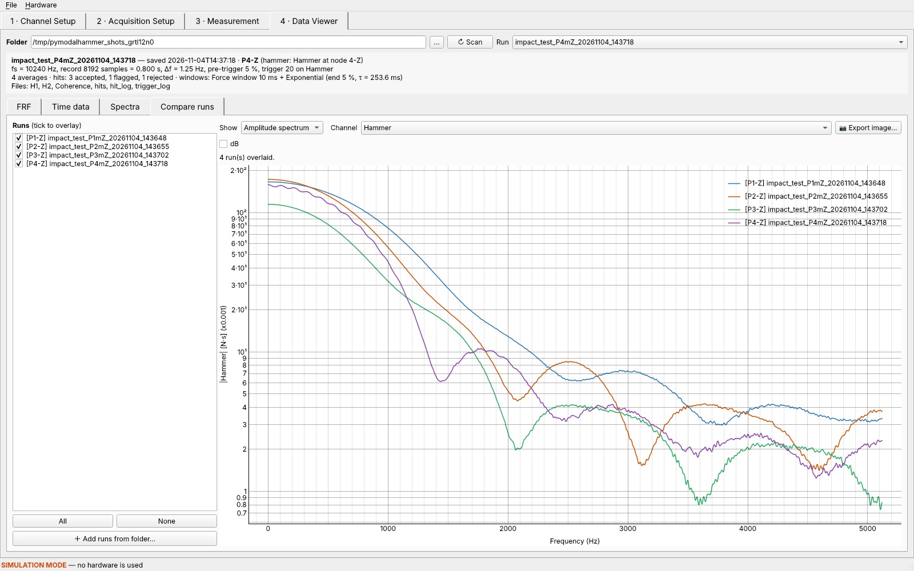

Every view has an /Export image…/ button (PNG at 2× resolution, SVG or PDF).

* Saved files
Each saved point goes to its own folder:
#+begin_example
roving hammer:  <folder>/<base>_P<node><direction>_<date>_<time>/
                e.g.  impact_test_P3mZ_20261104_142533/
fixed hammer:   <folder>/<base>_fixed_<date>_<time>/
#+end_example
(=p= and =m= stand for + and − in the direction; =_2=, =_3= … are added if two points are saved
within the same second.)

#+ATTR_LATEX: :environment tabularx :width \textwidth :align l|X
| File                         | Contents                                                                                                   |
|------------------------------+------------------------------------------------------------------------------------------------------------|
| =setup.json=                 | every setting, plus a =run= block: actual sampling rate, number of averages, hit counts, τ of the exponential window |
| =<base>_H1.uff= (H2, Hv)     | UFF dataset 58, function type 4 (FRF), complex, one record per response, from Δf to fs/2                   |
| =<base>_Coherence.uff=       | UFF 58, function type 6                                                                                    |
| =<base>_AutoSpectra.uff=     | optional: averaged auto-spectra of the hammer and every response, function type 2                          |
| =<base>_time.uff=            | optional: the averaged hits as time responses, function type 1, t = 0 at the trigger point                 |
| =<base>_hits.tdms=           | the averaged hits (optionally also the rejected ones), one group per hit                                   |
| =<base>_hit_log.csv=         | one line per hit                                                                                           |
| =<base>_trigger_log.csv=     | one line per external-trigger pulse                                                                        |
| =<base>_stream_<time>.tdms=  | optional, in the main folder: the complete continuous record                                               |

** UFF 58 records
Each record carries the response name, node and direction, and the reference (hammer) name, node
and direction (direction codes ±1/2/3 for ±X/Y/Z), the units of response and reference, and an ID
line such as =H1 Acc_2 5+Z / Hammer 3-Z=. The frequency axis starts at Δf (DC is left out).

** TDMS hit file
- File properties: base name, sampling rate, record length, pre-trigger samples, trigger level and
  slope, windows, averages, point node/direction/mode and the external-trigger settings.
- One group per hit, =Hit_001=, =Hit_002= …, with these properties:
#+ATTR_LATEX: :environment tabularx :width \textwidth :align l|X
| Property                         | Meaning                                                               |
|----------------------------------+-----------------------------------------------------------------------|
| status, included, reason         | as in the hit list; included is true for averaged hits                |
| checks                           | the result of every check                                             |
| trigger_sample, trigger_time_s   | the trigger point, from the start of the segment                      |
| segment, wall_time               | acquisition segment (each Start or Continue), computer clock time     |
| pre_samples                      | pre-trigger length in samples                                         |
| trigger_pulses                   | sample indices of the external-trigger pulses tied to the hit         |
| peak_<channel>                   | largest absolute value of each channel                                |

- One channel per sensor, plus =Trigger= with the hardware-timed trigger output. Every channel
  carries =wf_increment= (1/fs) and =wf_start_offset= (minus the pre-trigger time, so that t = 0 is
  the trigger point), so programs that read TDMS waveforms get the right time axis. Further
  properties: unit, node, direction, sensor type, sensitivity, physical channel and range.

** CSV logs
The hit log, =<base>_hit_log.csv=, has one line per hit:
#+ATTR_LATEX: :environment tabularx :width \textwidth :align l|X
| Column                       | Meaning                                                              |
|------------------------------+----------------------------------------------------------------------|
| hit, segment                 | hit number within the point, acquisition segment                     |
| status, included             | accepted / flagged / rejected; 1 if averaged                         |
| trigger_sample               | sample index of the trigger point from the start of the segment      |
| trigger_time_s, wall_time    | the same in seconds; the computer's clock time                       |
| peak_<channel>_<unit>        | one column per channel: the largest absolute value in the record     |
| reason                       | why the hit was flagged or rejected, and your decisions              |
| trigger_pulse_samples        | sample indices of the external-trigger pulses tied to this hit       |

The trigger log, =<base>_trigger_log.csv=, has one line per external-trigger pulse:
#+ATTR_LATEX: :environment tabularx :width \textwidth :align l|X
| Column                  | Meaning                                                                       |
|-------------------------+-------------------------------------------------------------------------------|
| pulse, segment          | pulse number, acquisition segment                                             |
| reason, hit             | why it was sent (start, hit detected, accepted hit, point complete …), which hit |
| sample_index, time_s    | when the pulse started, from the start of the segment                         |
| sample_exact            | 1 for hardware-timed pulses (exact), 0 for on-demand pulses (approximate)     |
| requested_at_sample     | the sample at which the program asked for the pulse                           |
| delay_after_request_ms  | the delay between the request and the pulse (≈ the output queue)             |

** Reading the files in Python
#+begin_src python
from nptdms import TdmsFile
import pyuff

f = TdmsFile.read("impact_test_hits.tdms")
for g in f.groups():
    if g.properties["included"]:
        acc = g["Acc_1"]
        t = acc.time_track()              # seconds; 0 = trigger point
        print(g.name, g.properties["status"], acc[:].max())

for rec in pyuff.UFF("impact_test_H1.uff").read_sets():
    print(rec["id1"], rec["x"][:3], rec["data"][:3])
#+end_src

* How it works
** Hit detection
The inputs are read in pieces (/read size/) into a ring buffer that always holds more than one
record. In every new piece the trigger channel is searched for the first sample that crosses the
level, after the signal has dropped below the re-arm level. A crossing at sample s starts the record
[s − pre, s − pre + N). When its last sample has arrived, the record is copied, the pre-trigger mean
is subtracted (if chosen) and the checks run. The next search starts after the end of the record
(plus the hold-off).

** Spectra and FRF estimators
Each hit's spectra are the windowed Fourier transforms \(X(f) = \mathrm{DFT}(x \cdot w)/f_s\), in
EU·s. With X the hammer and Y a response, averaged over the hits used:
\[ G_{xx} = \langle |X|^2 \rangle,\quad G_{yy} = \langle |Y|^2 \rangle,\quad G_{xy} = \langle X^* Y \rangle \]
\[ H_1 = \frac{G_{xy}}{G_{xx}},\qquad H_2 = \frac{G_{yy}}{G_{xy}^*},\qquad
   H_v = \frac{G_{xy}}{G_{xx} - \lambda_{\min}},\qquad \gamma^2 = \frac{|G_{xy}|^2}{G_{xx}\,G_{yy}} \]
where \(\lambda_{\min}\) is the smaller eigenvalue of
\(\begin{bmatrix} G_{xx} & G_{xy}^* \\ G_{xy} & G_{yy} \end{bmatrix}\). H1 suits noise on the
response, H2 noise on the force; Hv lies between them. For an impact test H1 is the usual choice.

** Checks in detail
- *Overload*: max |x| of each channel compared with the given percentage of its range.
- *Double hit*: from the hammer's peak, the end of the pulse is the first sample below 5 % of the
  peak; 0.3 ms later the remaining record is searched for |force| above the given percentage.
- *Not decayed*: \(\sqrt{2}\,\mathrm{RMS}\) of the last 5 % of each response record, as a percentage of
  that response's peak.

* Hardware notes
- *Sampling rates.* Delta-sigma modules (NI 9234, 9250, 9260 …) accept only certain rates
  (51.2 kHz / n); the rate really used is read back, logged and saved.
- *IEPE.* The NI 9234 and 9250 supply 2 mA only. Use AC coupling for IEPE sensors and allow a few
  seconds of settling.
- *Filter delay.* Delta-sigma inputs delay every sample by the module's filter group delay (≈ 38
  samples on the NI 9234). It does not affect the FRFs (all inputs share it), but an external-trigger
  pulse is practically undelayed, so camera frame f matches input sample f + delay. For sub-sample
  certainty, also record the trigger line on a spare input.
- *Analog trigger outputs on the NI 9260* (delta-sigma): use hardware timing, pulses of ≥ 10 samples,
  and a level within ±4.24 V. Its reconstruction filter delays and rounds the pulse; a digital line
  (NI 9401) gives clean edges.
- *Digital lines on the NI 9401* are set as inputs or outputs in groups of four; its outputs are 5 V TTL.
- *USB.* Keep the read size ≥ 20 ms. The /Input backlog/ indicator warns if the computer falls behind.

* Troubleshooting
#+ATTR_LATEX: :environment tabularx :width \textwidth :align X|X
| Symptom / message                                                    | Cause and remedy                                                                                                         |
|----------------------------------------------------------------------+--------------------------------------------------------------------------------------------------------------------------|
| No hits are detected                                                 | Trigger level too high, or wrong channel or slope. Probe the structure and use the suggested level. Wait for =ARMED=.    |
| Hits trigger by themselves                                           | Level too close to the noise: raise it, or raise /Re-arm below/ and the hold-off.                                       |
| Many double hits                                                     | Let the hammer rebound freely; use a lighter hammer or a harder tip; strike with a flick of the wrist.                   |
| Overloads                                                            | Hit more softly or raise the channel's range (Probe mode suggests one).                                                  |
| Coherence low at high frequencies                                    | The tip does not excite them: use a harder tip; check the hammer spectrum's −10 dB frequency.                            |
| Peaks too wide / damping too high                                    | The exponential window adds damping: weaken it, lengthen the record, or subtract the added damping.                                    |
| "Task contains physical channels … require you to specify the Sample Clock rate" (−201087) | The output module (e.g. NI 9260) cannot be switched on demand: use hardware timing.                    |
| "Requested sample clock source is invalid" (−200414)                 | Only with /Clocked by the AI sample clock/; the program falls back by itself. Choose /Own clock/ to avoid the message.   |
| "Onboard device memory underflow" (−200621)                          | The trigger output ran dry: raise /Output queue/ (1000–2000 ms), close other programs, or use a DO line on demand.       |
| "PC is falling behind"                                               | Increase the read size, close other programs, avoid very high sampling rates over USB.                                   |
| Window too large for the screen                                      | Every tab scrolls; drag the dividers between panels to give space where you need it.                                    |

* Testing and development
The folder =tests= holds automated tests that run without hardware:
#+begin_src sh
# engine, checks, averaging, trigger output, files
python tests/test_core.py
# NI back end against a mock driver with the limits of the NI 9260
python tests/test_ni_mock.py
# the whole GUI workflow in simulation (screenshots go to out/)
QT_QPA_PLATFORM=offscreen python tests/gui_smoke.py out/
# roving hammer with auto-advance
QT_QPA_PLATFORM=offscreen python tests/gui_autoadvance.py
# probe mode shows the trigger pulse
QT_QPA_PLATFORM=offscreen python tests/gui_probe_pulse.py
#+end_src
The tests use their own settings, so they never change your saved setup. The screenshots in this
manual are made by =tools/make_screenshots.py= from a simulated session.

To build this manual as a PDF: open it in Emacs and press =C-c C-e l p=, or run
=docs/export_pdf.sh=. It uses XeLaTeX and the DejaVu fonts (both part of common Linux and TeX Live installations).

* Reporting problems
Please include: the version (in the window title), the operating system, the NI hardware (chassis
and modules), the setup file (/File → Save setup as…/), the full text of any error message, and the
lines of the log at the bottom of the Measurement tab. For questions about results, the point's
folder (or its =setup.json= and =hit_log.csv=) helps most.

* Licence
#+begin_example
pymodalhammer — impact-hammer modal testing with NI-DAQmx
Copyright (C) 2026  The pymodalhammer authors

This program is free software: you can redistribute it and/or
modify it under the terms of the GNU General Public License as
published by the Free Software Foundation, either version 3 of
the License, or (at your option) any later version.

This program is distributed in the hope that it will be useful,
but WITHOUT ANY WARRANTY; without even the implied warranty of
MERCHANTABILITY or FITNESS FOR A PARTICULAR PURPOSE. See the GNU
General Public License for more details.

You should have received a copy of the GNU General Public License
along with this program (the file LICENSE). If not, see
<https://www.gnu.org/licenses/>.
#+end_example
